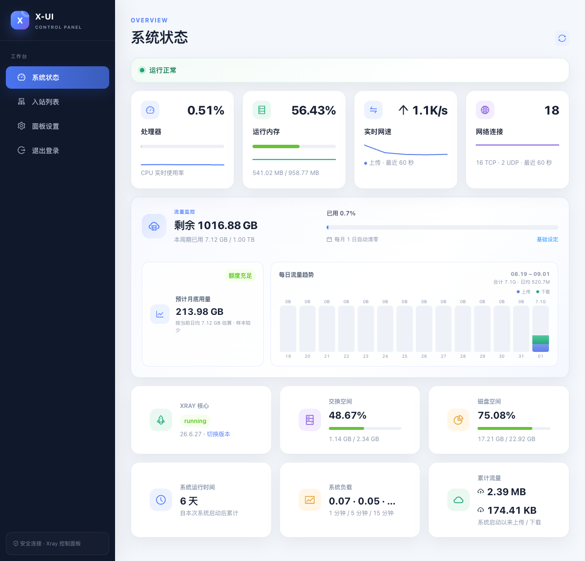
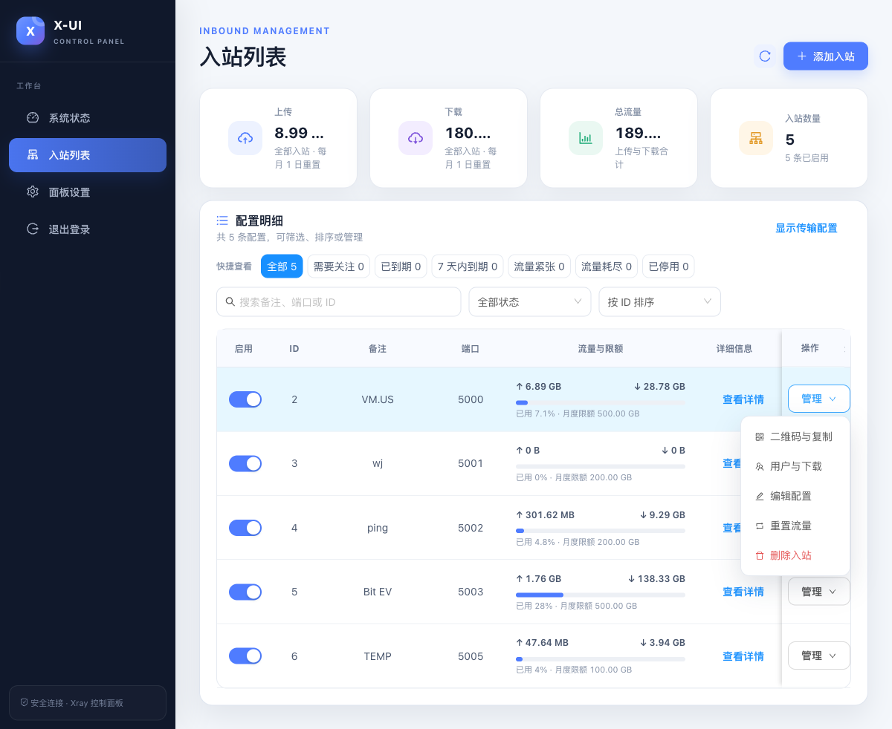
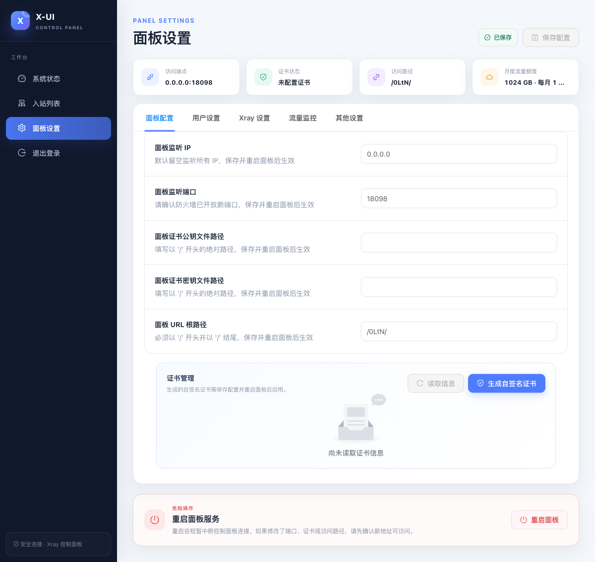

# X-UI Lite

> 面向日常服务器运维的 Xray 控制面板：把运行健康、流量与 VLESS 入站管理收敛到更清晰的工作流。

本仓库基于 [FranzKafkaYu/x-ui](https://github.com/FranzKafkaYu/x-ui) 演进，保留原项目的 GPL-3.0 许可证和署名。

[](https://github.com/chung4u/x-ui-lite/releases/latest)
[](./LICENSE)

## 一键安装

在目标服务器以 `root` 身份执行：

```bash
bash <(curl -fsSL https://raw.githubusercontent.com/chung4u/x-ui-lite/main/scripts/install.sh)
```

安装器下载当前 **v1.1.0** 预编译包，自动识别 Linux amd64 或 arm64。发行包内置 Xray 26.11.9。

首次安装会输出完整访问地址、管理员账号、随机密码及防火墙处理结果。默认端口为 `54321`，默认账号为 `admin`。通过安装器输出的 SSH 隧道指引完成初次登录，或通过 HTTPS 管理。升级前请确认管理入口并备份数据库。[管理员安全升级](docs/admin-upgrade.md)

## 核心功能

| 能力 | 解决的问题 |
| --- | --- |
| 运行健康优先 | 正常时只保留简洁状态；异常时集中展示需要处理的项目，减少无效信息。 |
| 服务器流量监控 | 支持月度额度、每月 1–31 日重置、近 14 天趋势和月底用量预估。 |
| 实时运维视图 | 处理器、内存、实时上传速率与网络连接优先展示；网速和连接数提供近 60 秒趋势。 |
| VLESS 入站管理 | 支持 TCP REALITY、经前端转发的 REALITY 与托管 XHTTP 入口，提供公开连接参数和证书检查。 |
| 用户与订阅分发 | 在同一工作区管理用户、个人额度和到期时间，导出 VLESS 链接、订阅地址和 Clash Verge 配置。 |
| REALITY 配置辅助 | 选择候选站点时匹配 SNI 与握手目标，可从服务器核验，并提供密钥和随机 Short ID 工具。 |
| 设置更可控 | 流量配置可靠保存，支持时区、证书关键信息读取和自签名证书生成。 |

## 产品界面

### 运行状态

实时资源、连接和流量聚合在一个页面；运行健康在正常时保持克制，异常时才展开具体问题。



### 入站管理

列表以流量与限额为核心，支持筛选、单独用户、订阅与客户端配置分发。



### 面板设置

将访问入口、证书、Xray、流量监控与其他设置统一组织，保存状态清晰可见。



## 使用说明

- 网页管理流程专注于 VLESS；已有非 VLESS 入站不会在此界面中创建或编辑。
- 使用 REALITY 时请通过预设站点选择握手目标，修改后重新导入用户订阅或客户端配置。
- 更新安装保留 `/etc/x-ui/x-ui.db` 中的面板数据和账号，并自动迁移管理员密码存储格式。

### Hysteria 2（可选）

在同一主机部署独立的 Hysteria 2 服务，将 HTTP 认证指向 `http://127.0.0.1:18741/auth`，并让流量统计接口监听 `127.0.0.1:18742`。面板与统计接口使用相同密钥，面板从 `XUI_HY2_SECRET` 读取。将服务的公开域名和 UDP 端口写入 `XUI_HY2_PUBLIC_ADDR`，例如 `hy2.example.com:443`，证书须覆盖该域名。

Hysteria 2 每次启动时应生成新的进程标识并写入 `XUI_HY2_EPOCH_FILE` 指定的文件，默认路径为 `/run/x-ui-hy2/epoch`。面板据此区分重启前后的流量计数。同一用户的 VLESS 和 Hysteria 2 用量计入同一额度。

完整更新记录见 [CHANGELOG.md](./CHANGELOG.md)。
